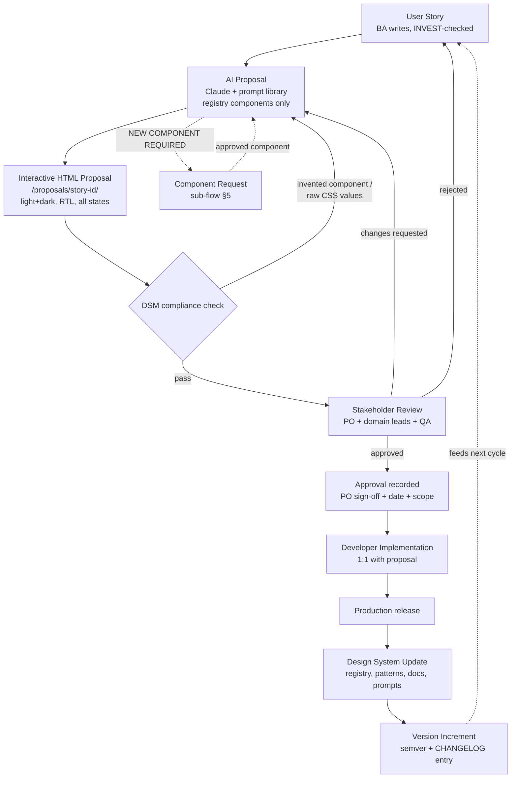
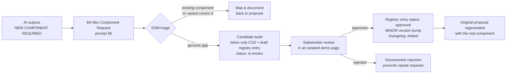

# HighFive Design System — Governance Workflow

**Version:** 1.0.0 · **Last updated:** 2026-07-17

This document defines how a business need becomes production UI, who owns each stage, and
how the Design System itself evolves. The governing principle: **the Design System is the
single source of truth; every change to it is deliberate, reviewed, and versioned.**

---

## 1. Roles & responsibilities

| Role | Owns | Key duties |
|---|---|---|
| **Business Analyst (BA)** | User stories, AI proposals | Writes complete stories (see [`01-business-guide.md`](01-business-guide.md)), generates proposals with the approved prompts, iterates on review feedback |
| **Product Owner (PO)** | Approval decisions | Reviews interactive proposals against business goals, approves/rejects/returns, prioritizes component requests |
| **Design System Maintainer (DSM)** | The system itself | Guards the registry, reviews proposals for system compliance, owns tokens/CSS, runs versioning and changelog, audits quarterly |
| **Developer** | Production implementation | Implements approved proposals 1:1 using referenced components, raises deviations back to DSM instead of improvising |
| **Stakeholders** (dept leads, QA, compliance) | Domain sign-off | Review proposals in their domain; QA validates acceptance criteria & accessibility before production |

### RACI

| Stage | BA | PO | DSM | Dev | Stakeholders |
|---|---|---|---|---|---|
| User story | **R/A** | C | — | — | C |
| AI proposal generation | **R** | I | C | — | — |
| System-compliance check | C | I | **R/A** | — | — |
| Stakeholder review | R | **A** | C | C | **R** |
| Approval | I | **R/A** | C | I | C |
| Implementation | C | I | C | **R/A** | — |
| Production release | I | A | C | **R** | QA: R |
| Design System update | I | I | **R/A** | C | — |
| Version increment & changelog | — | I | **R/A** | — | — |

R = Responsible, A = Accountable, C = Consulted, I = Informed.

---

## 2. The pipeline



Plain-text form:

```
User Story → AI Proposal → Interactive HTML Proposal → Stakeholder Review
→ Approval → Developer Implementation → Production
→ Design System Update → Version Increment
```

---

## 3. Stage definitions (entry / exit criteria)

### 3.1 User Story — *owner: BA*
- **Entry:** validated business need.
- **Exit:** story follows the template in [`01-business-guide.md`](01-business-guide.md) §2 —
  role, outcome, data with realistic examples, single primary action, states, testable
  acceptance criteria, out-of-scope list.

### 3.2 AI Proposal — *owner: BA (Claude executes)*
- **Entry:** complete story; prompt from [`04-ai-prompts.md`](04-ai-prompts.md).
- **Exit:** interactive HTML file + "Components used" appendix (registry ids) + any
  `NEW COMPONENT REQUIRED` declarations. No invented components, no raw CSS values,
  no frameworks.

### 3.3 Interactive HTML Proposal — *the review artifact*
- Self-contained page in `/proposals/<story-id>/` linking the existing stylesheets and shell.
- Must demonstrate: light + dark theme, RTL, mobile (≤768px), loading/empty/no-results/error
  states, and every acceptance criterion.
- **This artifact — not a static mock — is what gets approved.** What stakeholders click is
  what developers build.

### 3.4 Stakeholder Review — *owner: PO*
- Review happens in the browser against the acceptance criteria, plus the review checklists
  (design / accessibility / responsive prompts in [`04-ai-prompts.md`](04-ai-prompts.md) §3, §7, §8).
- Outcomes: **approved** · **changes requested** (back to 3.2 with written deltas) ·
  **rejected** (back to the story).
- Target SLA: first review within 3 working days of submission.

### 3.5 Approval — *owner: PO*
- Recorded in the proposal folder (`APPROVAL.md`): approver, date, proposal file hash/version,
  scope notes. Verbal approval is not approval.
- After approval the proposal is **frozen** — further changes are new modification requests.

### 3.6 Developer Implementation — *owner: Developer*
- Implements against the frozen proposal using the same registry components.
- **Deviation rule:** if implementation reveals a problem (perf, feasibility, edge case),
  the developer raises it to the DSM/PO; the proposal is amended and re-approved (fast-track
  review). Silent divergence between proposal and production is the failure mode this whole
  process exists to prevent.

### 3.7 Production — *owner: Developer + QA*
- QA validates acceptance criteria, accessibility (keyboard, contrast, reduced motion),
  and responsive behaviour before release.

### 3.8 Design System Update — *owner: DSM*
After each production release, the DSM applies the system feedback loop:
- New/changed components → registry entries updated (status, versions, usage examples).
- New composition worth reusing → pattern entry in [`../patterns/`](../patterns/).
- Docs and the prompt library updated if the release changed guidance.

### 3.9 Version Increment — *owner: DSM*
- Semver bump + [`05-CHANGELOG.md`](05-CHANGELOG.md) entry (rules in §6 below).

---

## 4. Proposal folder convention

```
/proposals/
  BK-102-refunds-queue/
    proposal.html        ← the interactive artifact
    STORY.md             ← the user story as generated against
    COMPONENTS.md        ← registry ids used + any NEW COMPONENT REQUIRED
    APPROVAL.md          ← added at stage 3.5; freezes the proposal
    revisions/           ← superseded versions, kept for audit
```

---

## 5. Sub-flow: NEW COMPONENT REQUIRED



Triage bar for a true component (vs. a variant or pattern):
1. Needed on **two or more** screens, and
2. not expressible as a variant/state of an existing component, and
3. carries its own interaction behaviour or semantics.

After approval, the DSM must update **all seven** feedback targets:
**Component Registry · Pattern Library · Documentation · Version · Changelog · AI Prompt
Library · Governance docs** (if the change altered process). The Maintenance prompt
([`04-ai-prompts.md`](04-ai-prompts.md) §5) automates the sweep.

---

## 6. Versioning rules (system-level)

Semantic Versioning `MAJOR.MINOR.PATCH` — details and examples in
[`05-CHANGELOG.md`](05-CHANGELOG.md).

| Bump | When |
|---|---|
| **MAJOR** | Breaking change to existing markup contracts or class names; token removals/renames; removal of deprecated components |
| **MINOR** | New component, new variant, new pattern or template; deprecations; new token additions |
| **PATCH** | Bug fixes, doc corrections, non-breaking CSS fixes, a11y fixes that don't change markup |

Per-component versions live in each registry entry and move independently; the system
version is bumped once per release batch.

---

## 7. Governance principles

1. **The proposal is the spec.** If it isn't in the approved HTML, it isn't in scope.
2. **No unreviewed UI reaches production.** Including "tiny" changes — they ride the
   modification flow with a fast-track review.
3. **The registry is closed-world for AI.** Anything outside it requires the §5 sub-flow.
4. **Every decision leaves a written trace** (story, COMPONENTS.md, APPROVAL.md, changelog).
5. **Feedback loops are mandatory, not best-effort** — stage 3.8 is a release step, not
   housekeeping.
